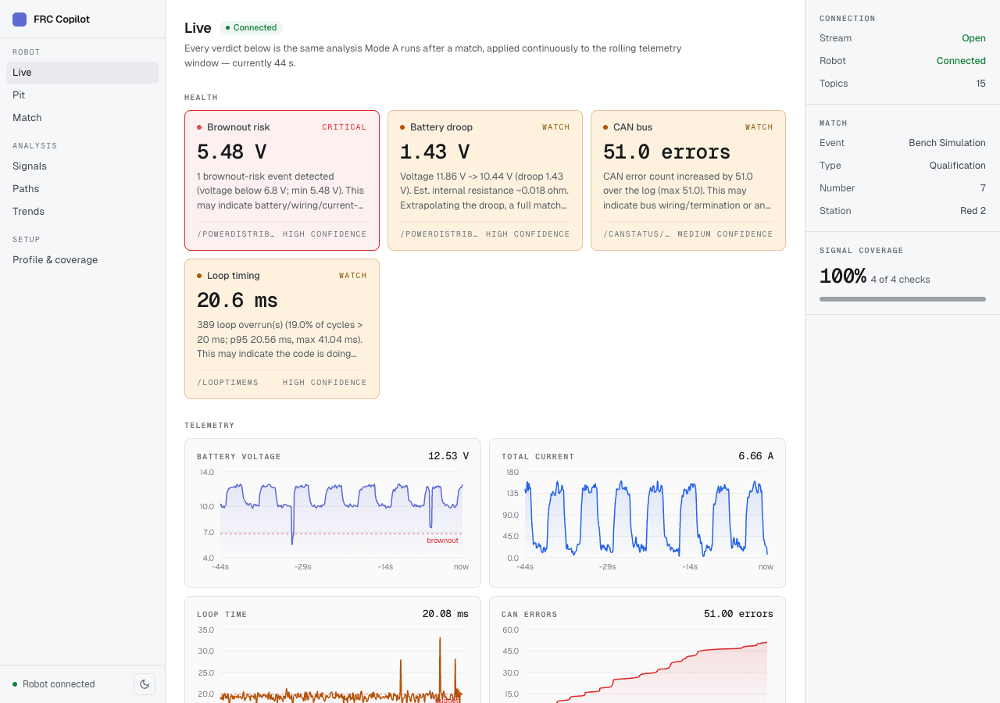

# FRC AI Copilot

[](https://github.com/yajatp/frc-ai-copilot-public/actions/workflows/build.yml)
[](LICENSE)
[](#requirements)

**Match-log diagnostics and simulation-backed autonomous tuning for FIRST Robotics Competition teams.**

FRC AI Copilot reads WPILib and REV logs, surfaces likely electrical and timing problems, and lets teams evaluate autonomous changes against explicit checks in simulation or recorded replay. The project was built for Team 6369 (Mercenary Robotics) and Team 6773.

[Try it with synthetic logs](#try-it) · [Set up an editor](docs/SETUP.md) · [Explore the closed loop](docs/CLOSED-LOOP.md)

The core is Java with SQLite and an MCP server. Teams can use it from their editor, the command line, or a local dashboard. Proposed edits are reviewable, and the simulation and replay workflow runs separately from the live robot.



*Dashboard running against the bundled simulated robot.*

## Why it's built this way

Teams don't recompile robot code at competition — they tweak autonomous paths. So there are two
modes, and they have genuinely different budgets:

- **Mode A — between matches.** Fast and narrow. Brownout, battery, CAN and loop-timing flags, plus
  PathPlanner waypoint and timing suggestions. You have the gap between two matches, so this pass
  stays cheap and runs automatically as logs appear.
- **Mode B — after the event.** The deep work. Full audits, season trends, and the closed-loop
  code-improvement cycle, where there's time to chase a hypothesis properly.

Two principles run through everything:

**Nothing is stated with more confidence than the data supports.** Every analysis result carries a
sample count, a timing-regularity check and a confidence level, and the language is hedged to match.
A single match is rarely conclusive, and the tool says so instead of sounding certain.

**Nothing writes without showing you first.** Every edit is a reviewable diff, dry-run by default,
and writes only to a file you name — the original is never overwritten in place. The live robot
connection is read-only.

## What it does

| Area | What you get |
|---|---|
| **Log analysis** | `.wpilog` parsing with struct decoding (Pose2d, SwerveModuleState, …), and 15 composable primitives: power/brownout, battery, CAN, loop timing, swerve/PID, vision, cycle times, anomalies, peaks, correlation, comparison |
| **Season trends** | Every ingested log's metrics in a local SQLite store, so a season query is a database read rather than a re-parse of every log |
| **Robot profile** | Bootstrapped from your repo — PathPlanner settings, CAN IDs, vendordeps — so analysis is specific to your robot instead of generic |
| **Between-match automation** | A log-watcher daemon that spots new logs on a USB drive or in the Driver Station folder, runs the Mode A pass, and records the results |
| **Autonomous editing** | PathPlanner `.path` and `.auto` edits as reviewable diffs: waypoint fudging, global speed, event-marker timing, and per-zone constraints |
| **Live telemetry** | NetworkTables 4 read access, with a hard safety boundary on the single write path |
| **Closed loop** | edit → build → run → verify → diagnose → iterate, against headless simulation or a replay of a recorded match |
| **Offline docs** | Local full-text search over WPILib, CTRE Phoenix 6, PhotonVision and PathPlanner docs plus the game manual, page-cited. No network, which matters in a pit |
| **Dashboard** | A local web UI over all of it — live health tiles, pit and match views, signals, paths, trends, profile |
| **Small models** | Train a tiny, inspectable classifier from a few moments you mark in a log, for the judgement calls no sensor reports |

Everything is reachable three ways: as MCP tools (46 of them), as module CLIs, and — for the
analysis and telemetry parts — in the dashboard.

## Requirements

The WPILib 2026 install, which provides the JDK and an offline Maven repository. That's it; there is
no network dependency at runtime.

One caveat worth knowing before an event rather than in a pit: if you point the **closed loop** at
your own robot project, its first build resolves that project's vendordeps — PathPlanner,
AdvantageKit, Phoenix 6 — which are *not* in WPILib's offline repo and have to come from the
internet once. After that they are cached and the loop runs offline like everything else. Run one
build at home.

Runs on **Windows, macOS and Linux** (x64 or ARM). The correct native libraries are selected
automatically from the machine you build on.

Built on WPILib, PathPlanner, and maple-sim for physics simulation.

## Build

All build state stays inside the project folder:

```bash
# macOS / Linux
export JAVA_HOME=~/wpilib/2026/jdk
export GRADLE_USER_HOME="$PWD/.gradle-home"
./gradlew build          # compile + test everything
```

```powershell
# Windows (PowerShell)
$env:JAVA_HOME = "$HOME\wpilib\2026\jdk"
$env:GRADLE_USER_HOME = "$PWD\.gradle-home"
.\gradlew.bat build
```

New here? [CONTRIBUTING.md](CONTRIBUTING.md) is the walkthrough, including the first-run steps that
aren't obvious. [docs/SETUP.md](docs/SETUP.md) covers registering the MCP server with your editor.

## Use it from Claude Code

Register the server for this project, then restart Claude Code and approve it:

```bash
node scripts/claude-code-install.js
```

It builds the server if needed, finds the JDK, and writes `.mcp.json` with the platform-correct
launcher — on Windows that is `cmd.exe /c mcp-server.bat`, which a hand-written entry usually gets
wrong. `.mcp.json` is gitignored because the paths in it are absolute, so run this once per machine.

After that, **ask it to get started** — "help me get started with FRC Copilot" — and it checks what
this checkout already has, does only what's missing, opens the dashboard and hands you a menu of
what to ask for. The team's conventions ship alongside it in [`skills/`](skills/): AdvantageKit
patterns, PathPlanner, Phoenix 6, PhotonVision, REV, subsystem scaffolding and sim-in-the-loop.

Using something else? There are installers for Cursor, Codex and Antigravity, and an extension for
VS Code — see [docs/SETUP.md](docs/SETUP.md).

## Start here: point it at your robot

Everything else reads a **robot profile** — your CAN IDs, drivetrain geometry, PathPlanner settings
and vendordeps — so analysis is about your robot rather than a generic one. Generate it from your
existing robot repository; nothing needs to be filled in by hand:

```bash
./gradlew :profile:installDist
profile/build/install/profile/bin/profile init /path/to/your-robot-repo profiles/my-robot.yaml 1234 myrobot
```

Or ask your AI assistant to call `profile_init`, which does the same thing and defaults to a dry run.

**Read the warnings it prints.** It flags CAN IDs your code marked `TODO` or `NOT ACCURATE`, and a
wrong CAN ID sends someone to check the wrong motor. Everything else it extracts is parsed from your
source, not guessed.

## Try it

Real logs are gitignored — they're data, not source — so generate a synthetic 150-second match
first. It contains a real brownout, a CAN error burst, loop overruns and vision dropouts, so every
primitive has something to report:

```bash
./gradlew :core-ingest:installDist :analysis:installDist
core-ingest/build/install/core-ingest/bin/core-ingest gen demo.wpilog

analysis/build/install/analysis/bin/analysis analyze demo.wpilog   # Mode A safety sweep
analysis/build/install/analysis/bin/analysis full    demo.wpilog   # + swerve/vision/cycles
analysis/build/install/analysis/bin/analysis                       # all subcommands
```

The dashboard, against a built-in simulated robot:

```bash
./gradlew :dashboard:installDist
dashboard/build/install/dashboard/bin/dashboard --sim --open
```

`--open` launches your browser at `http://localhost:5800` once the server is serving. Point it at a
real robot with `--team 6369` instead of `--sim`.

One turn of the closed loop, against a real WPILib robot running headless on simulated physics:

```bash
./gradlew :simreplay:installDist
simreplay/build/install/simreplay/bin/simreplay iterate example-robot/loop.yaml
```

## Documentation

| Doc | What's in it |
|---|---|
| [CONTRIBUTING.md](CONTRIBUTING.md) | Getting set up and finding your way around |
| [docs/SETUP.md](docs/SETUP.md) | Build details and registering the MCP server |
| [docs/CLOSED-LOOP.md](docs/CLOSED-LOOP.md) | How the closed loop works, sim and replay |
| [dashboard/README.md](dashboard/README.md) | The web UI |
| [skills/](skills/) | The FRC skill packs your assistant loads — conventions, vendors, scaffolding |
| [ROADMAP.md](ROADMAP.md) | What's planned next |

## Modules

| Module | What it does |
|---|---|
| `core-ingest` | `.wpilog` parsing, struct decoding, the SQLite trend store, match-data lookup, `.revlog` correlation |
| `profile` | Robot profile bootstrapped from the repo, plus bundled field and game data |
| `analysis` | The 15 analysis primitives, with the confidence guardrails |
| `write-layer` | PathPlanner `.path` / `.auto` editing as reviewable diffs, plus the deploy gate |
| `live-nt` | NT4 telemetry read, and the safety-scoped write boundary |
| `simreplay` | The closed loop: phase-aware assertions, failure diagnosis, baseline divergence, iteration journal, scenario generation |
| `modes` | Mode A orchestration and the log-watcher daemon |
| `smallmodel` | Small-model training from marked log examples |
| `knowledge` | The offline documentation and game-manual index |
| `mcp-server` | The MCP server exposing all 46 tools; start with `get_guide` |
| `dashboard` | The local web UI |
| `example-robot` | A real command-based robot on simulated physics — the worked example the closed loop drives |

## Credits

The project builds on WPILib, PathPlanner, maple-sim, and REV log formats. The REV decoder resources include their [upstream license notice](core-ingest/src/main/resources/revlog-dbc/LICENSE-REV-node-revlog-converter.txt).

## Source availability

This repository is the public release snapshot. It includes the source, sample robot, and synthetic demo. The development archive and local test artifacts are kept separately.

## License

[MIT](LICENSE) — use it, fork it, ship it on your robot. Attribution appreciated, not required.
